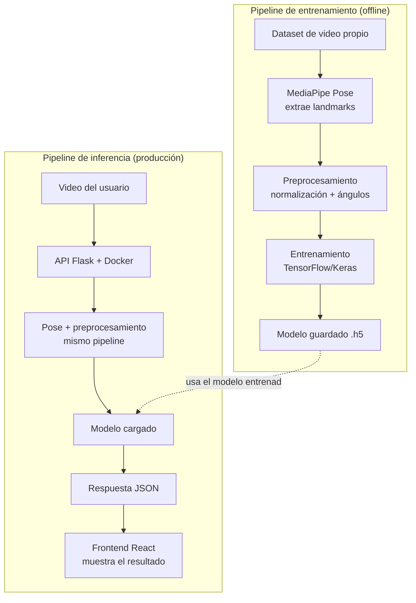

# Analizador de Técnica — Tenis de Mesa


**🔴 Demo en vivo:** [pongiq-murex.vercel.app](https://pongiq-murex.vercel.app) 

Sistema de visión por computador que analiza la técnica del **drive** y el **revés** en tenis de mesa a partir de un video subido o grabado, usando estimación de pose (MediaPipe) y un modelo de deep learning (TensorFlow) entrenado con un dataset propio, grabado y etiquetado por mí mismo.

## Por qué existe este proyecto

Jugué tenis de mesa competitivamente durante buena parte de mi niñez y adolescencia. Al cursar una especialización en Inteligencia Artificial, quise construir algo que combinara ambas cosas: aplicar visión por computador y deep learning a un problema donde mi criterio como jugador realmente importa, en donde definí qué hace que un golpe sea técnicamente correcto o no, y enseñarle eso a un modelo.

## Qué hace

1. El usuario sube un video (o graba directo con su cámara) ejecutando un drive o un revés.
2. El sistema extrae los puntos clave del cuerpo con MediaPipe Pose.
3. Calcula ángulos articulares (codo, cadera, altura de muñeca) definidos a partir de criterios técnicos reales de tenis de mesa.
4. Un modelo de red neuronal, entrenado con un dataset propio de ~71 repeticiones grabadas y etiquetadas manualmente, predice si la ejecución fue **correcta** o **incorrecta**, con un nivel de confianza.

## Arquitectura

Dos flujos separados: uno de entrenamiento (offline) y uno de inferencia (el que corre cuando alguien usa la app).



## Stack tecnológico

| Categoría | Tecnologías |
|---|---|
| Visión por computador | MediaPipe Pose, OpenCV |
| Machine Learning | TensorFlow/Keras, scikit-learn |
| Backend | Python, Flask, Flask-CORS |
| Frontend | React, Vite |
| Testing | pytest |
| CI/CD | GitHub Actions |
| Contenedores | Docker |
| Control de versiones | Git, GitHub |

## Dataset

Fue un dataset grabado y etiquetado a mano, con una clasificación automática de repeticiones por velocidad de movimiento de la muñeca:

| Categoría | Repeticiones |
|---|---|
| Drive correcto | 243 |
| Drive incorrecto | 45 |
| Revés correcto | 212 |
| Revés incorrecto | 38 |
| **Total** | **538** |

## Resultados

Se validó con **5-fold cross-validation** (no un solo entrenamiento, para evitar resultados optimistas por azar):

| Golpe | Accuracy promedio |
|---|---|
| Drive | 89.2% ± 4.7% |
| Revés | 94.4% ± 2.7% |
| Identificador de golpe | 89.2% ± 5.3% |

Ambos resultados se mantienen consistentemente por encima del 50% (azar en clasificación binaria), confirmando que el modelo captura una señal real — aunque con la variabilidad esperable de un dataset pequeño y propio.

## Limitaciones conocidas

- El identificador de tipo de golpe que construi(drive vs reves) tiene ~89% de accuracy, no es perfecto: en aproximadamente 1 de cada 9 casos puede confundir el tipo de golpe, especialmente en repeticiones incorrectas de reves.
- Los datos del jugador zurdo (normalizados con espejo de lateralidad) no se han validado aun con accuracy por separado del resto del dataset - el numero general mezcla diestro y zurdo sin desglosar..
- El angulo del lado opuesto que tome para el dataset tiene una limitacion de visibilidad conocida: en ciertos frames el brazo dominante queda oculto detras del torso, y MediaPipe puede inferir una posicion poco confiable en vez de reportarla como no visible.
- Los criterios de "correcto" e "incorrecto" se basan en mi experiencia propia como jugador, por lo que podria inferir entre un jugador u otro.
- El plan gratuito de hosting impone limites practicos: tamano maximo de video por peticion, y el servicio puede tardar en responder tras periodos de inactividad.


## Despliegue

- **Backend**: Docker en [Render](https://render.com), reentrenando el modelo automáticamente en cada build a partir del dataset versionado (`RUN python entrenar_final.py` dentro del Dockerfile) — garantiza que el modelo desplegado siempre coincide con el dataset del repositorio.
- **Frontend**: [Vercel](https://vercel.com), con la URL de la API inyectada vía variable de entorno (`VITE_API_URL`).

**Limitación conocida del plan gratuito:** el servicio de backend se "duerme" tras 15 minutos de inactividad (30-60s para despertar en la primera petición), por lo que genere un end-point para que se haga una intervencion cada diez minutos y evitar que se duerma y hay un límite práctico de tamaño/duración de video por petición — la API está diseñada para un solo golpe por video, no para sesiones de práctica completas.

## Cómo correrlo localmente

### Backend

```bash
cd analizador-tenis-de-mesa
python -m venv venv
venv\Scripts\activate          # Windows
pip install -r requirements.txt
python app.py
```

La API queda disponible en `http://127.0.0.1:5000`.

### Frontend

```bash
cd frontend
npm install
npm run dev
```

La interfaz queda disponible en `http://localhost:5173`.

### Tests

```bash
pytest test_features.py -v
```

## Estructura del repositorio

```
analizador-tenis-de-mesa/
├── app.py                     # API Flask
├── features.py                # Extracción de ángulos/features (con tests)
├── test_features.py           # Tests unitarios (pytest)
├── entrenar_drive.py          # Entrenamiento + evaluación del modelo de drive
├── entrenar_reves.py          # Entrenamiento + evaluación del modelo de revés
├── entrenar_final.py          # Modelos finales de producción (100% del dataset)
├── evaluar_cruzado.py         # Validación cruzada (5-fold)
├── requirements.txt
├── dataset/                   # Repeticiones segmentadas (.npy)
│   ├── drive/{correcto,incorrecto}/
│   └── reves/{correcto,incorrecto}/
├── docs/
│   └── criterios-tecnicos-golpes.md   # Documento de diseño técnico completo
├── .github/workflows/tests.yml        # CI/CD
└── frontend/                  # Interfaz en React
    └── src/
```

## Documentación técnica completa

El razonamiento detallado detrás de cada decisión técnica (criterios de golpes, arquitectura, calibración del dataset, bugs reales resueltos) está en [`docs/criterios-tecnicos-golpes.md`](docs/criterios-tecnicos-golpes.md).

## Autor

**Joan Sebastian Sanchez Acuña** — Ingeniero de Sistemas y Computación | Especialización en IA
[GitHub](https://github.com/Sebastian21sa)
